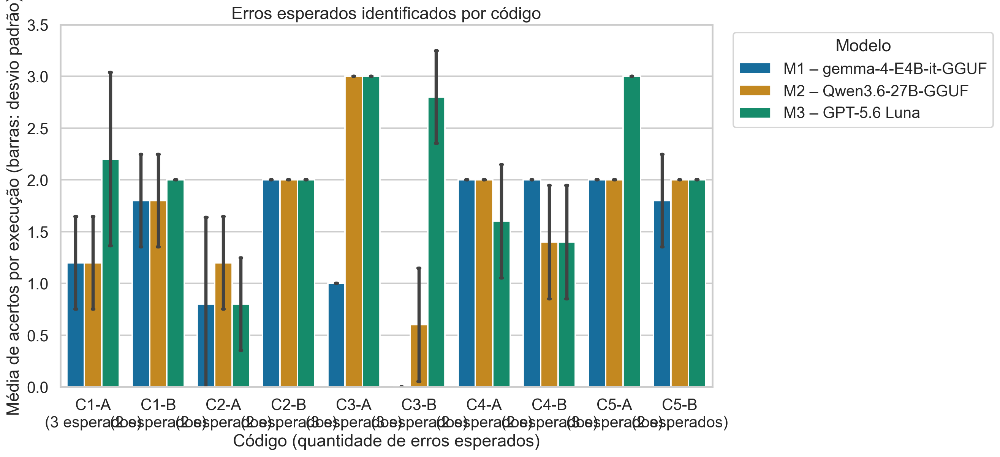
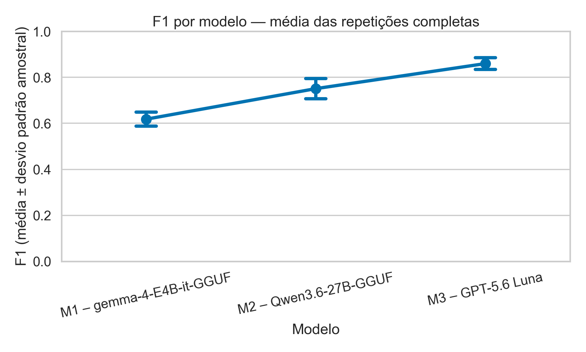
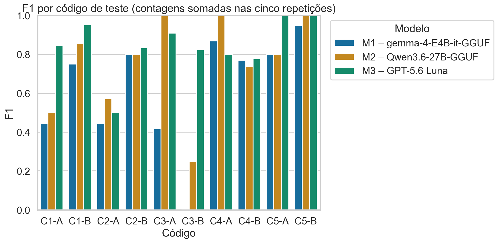
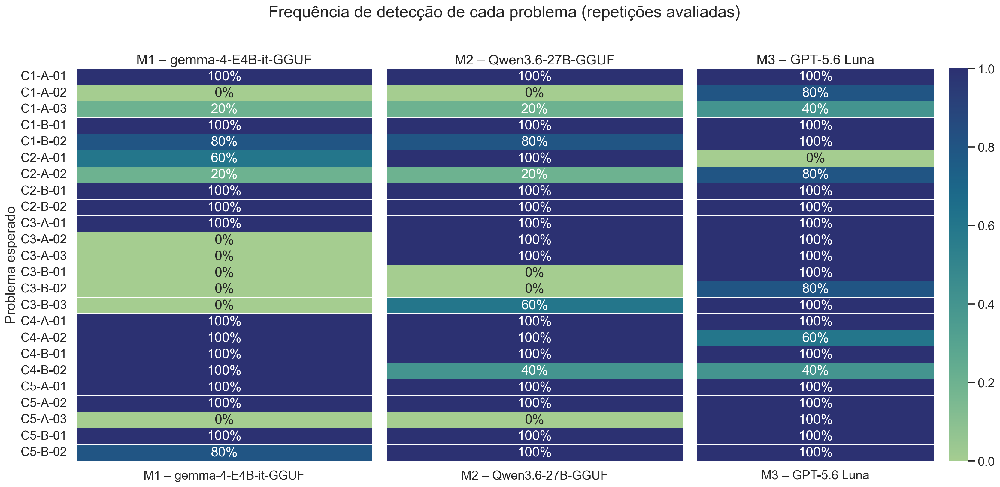

# Análise dos resultados do experimento ATLAS

Planilha analisada: `Execucoes_organizadas_M1_M2_M3_v2.xlsx`

Registros: 150. Rodadas completas por modelo e repetição: 15.
Registros duplicados (modelo, código, repetição): 0.
Inconsistências encontradas: 0.

## Comparação dos modelos

Métricas calculadas somando VP, FP e FN dentro de cada repetição completa; depois, média e desvio padrão entre repetições.

| Modelo | Precisão média | Revocação média | F1 médio ± DP | Rodadas |
|---|---:|---:|---:|---:|
| M1 – gemma-4-E4B-it-GGUF | 0.629 | 0.608 | 0.618 ± 0.031 | 5 |
| M2 – Qwen3.6-27B-GGUF | 0.790 | 0.717 | 0.751 ± 0.044 | 5 |
| M3 – GPT-5.6 Luna | 0.854 | 0.867 | 0.860 ± 0.026 | 5 |

## Observações metodológicas

- O F1 agregado usa `2 × VP / (2 × VP + FP + FN)`, conforme o plano de avaliação.
- As cinco repetições são descritas; não se afirma significância estatística nem superioridade universal.
- Os códigos e cenários são uma amostra experimental construída; as conclusões se limitam às condições avaliadas.
- A frequência por problema informa em quantas execuções avaliadas cada ID foi detectado.
- Para o líder de cada código, compara-se a média de VP por execução; empates são mantidos.

## Modelo com mais acertos por código

Os acertos são os IDs de problemas esperados identificados. O máximo possível depende do código; a comparação usa a média de VP por execução e considera todas as repetições avaliadas.

| Código | Erros esperados por execução | Modelo(s) com mais acertos | Média de acertos por execução |
|---|---:|---|---:|
| C1-A | 3 | M3 – GPT-5.6 Luna | 2.20 |
| C1-B | 2 | M3 – GPT-5.6 Luna | 2.00 |
| C2-A | 2 | M2 – Qwen3.6-27B-GGUF | 1.20 |
| C2-B | 2 | M1 – gemma-4-E4B-it-GGUF; M2 – Qwen3.6-27B-GGUF; M3 – GPT-5.6 Luna | 2.00 |
| C3-A | 3 | M2 – Qwen3.6-27B-GGUF; M3 – GPT-5.6 Luna | 3.00 |
| C3-B | 3 | M3 – GPT-5.6 Luna | 2.80 |
| C4-A | 2 | M1 – gemma-4-E4B-it-GGUF; M2 – Qwen3.6-27B-GGUF | 2.00 |
| C4-B | 2 | M1 – gemma-4-E4B-it-GGUF | 2.00 |
| C5-A | 3 | M3 – GPT-5.6 Luna | 3.00 |
| C5-B | 2 | M2 – Qwen3.6-27B-GGUF; M3 – GPT-5.6 Luna | 2.00 |

## Gráficos

